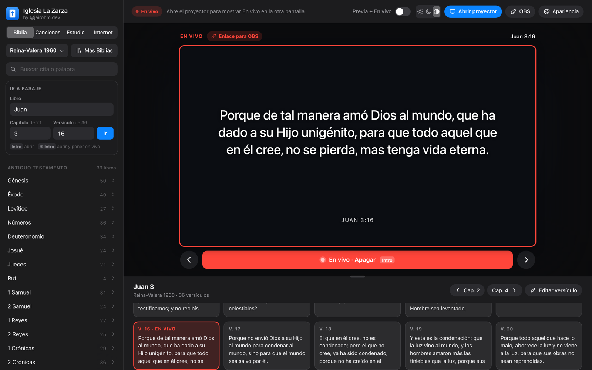
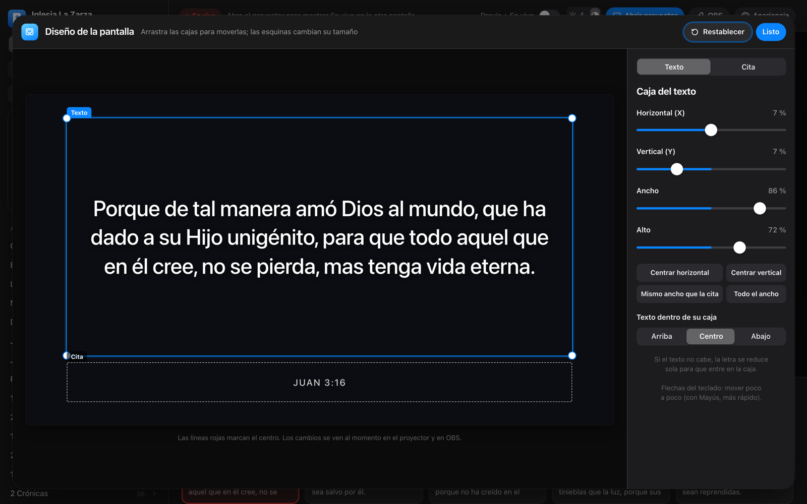
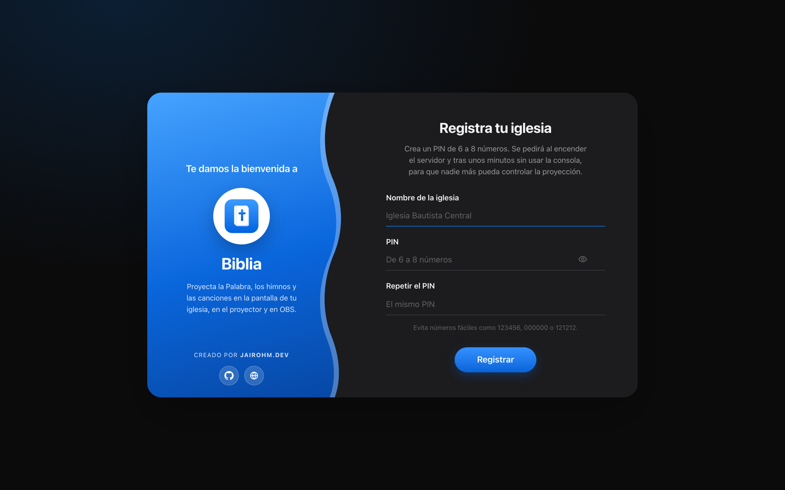

<div align="center">


# Biblia

**Consola de proyección para iglesias: la Palabra, los himnos y las canciones en el proyector y en OBS.**

Libre, ligera y segura. Funciona sin internet y en equipos modestos (4 GB de RAM).

[](LICENSE)


[](CONTRIBUTING.md)



</div>

---

## ✨ Qué hace

| | |
| --- | --- |
| 📖 **Biblia** | Reina-Valera 1960 incluida y más versiones descargables (RV1909, RV1865, KJV, WEB). Buscador que entiende citas: `Juan 3:16`, `jn 3 16`, `1 Co 13:4-7`, `Juan 3:16; Rom 8:28`. |
| 🎵 **Canciones** | Himnarios, tus propias canciones en carpetas y búsqueda de letras en internet (LRCLIB y el catálogo de Apple). |
| 🖼️ **Estudio** | Presentaciones con textos e imágenes libres, videos con barra de reproducción, audios y anuncios. |
| 🎨 **Apariencia** | Letra, colores, fondo con imagen, transiciones y animaciones del texto. Editor de diseño con **cajas arrastrables** para el texto y la cita, como en EasyWorship. |
| 🖥️ **Proyector** | Elige la pantalla y proyecta a pantalla completa. Modo **Previa + En vivo** para preparar lo siguiente. |
| 📡 **OBS** | Enlace para fuente de navegador, a pantalla completa o con fondo transparente para superponer a la cámara. |
| 🔒 **Seguridad** | PIN, llaves ECC por equipo y peticiones firmadas: pensado para el wifi público de una iglesia. |
| 🌗 **Diseño** | Interfaz al estilo de Apple, con tema claro, oscuro o automático. |

<div align="center">


</div>

## 🚀 Empezar

### Opción 1 · App de escritorio (recomendada)

Se instala como cualquier programa, sin terminal ni navegador: **Windows** `.exe` / `.msi`,
**macOS** `.dmg`, **Linux** `.AppImage` / `.deb`. Descárgala desde
[**Releases**](../../releases) o desde la pestaña **Actions** (artefactos de «App de escritorio»).

- Usa el motor web del sistema (WebView2 o WebKit), no un navegador completo: ocupa ~4 MB.
- No abre ningún puerto. **Transmitir a OBS** enciende un servidor solo para que OBS pueda *ver*.
- **macOS (sin firmar):** la primera vez, clic derecho sobre la app → **Abrir**. Si dice que «está
  dañada», ejecuta `xattr -cr /Applications/Biblia.app`.

### Opción 2 · Versión web con servidor local

Sin Node, sin Python, sin instalar nada: usa lo que ya trae el sistema.

```bash
git clone https://github.com/jairohm-dev/biblia-proyeccion.git
cd biblia-proyeccion
./serve.sh            # macOS / Linux → http://localhost:3737
```

En **Windows**, doble clic en `iniciar-windows.cmd`.

<details>
<summary>Más opciones del servidor</summary>

```bash
./serve.sh 4000               # otro puerto
./serve.sh --red              # OBS en otro equipo de la red (solo puede ver)
./serve.sh --restablecer-pin  # si olvidaste el PIN
./serve.sh --reiniciar        # todo desde cero (pide escribir BORRAR)
./serve.sh --ayuda            # todas las opciones
BIBLIA_SESION_MIN=30 ./serve.sh   # sesión de 30 min (por defecto, 12 horas)
```

En Windows: `iniciar-windows.cmd -Ayuda` (`-Red`, `-RestablecerPin`, `-Reiniciar`, `-SesionMin 30`).
En macOS usa el Apache del sistema; en Linux, el de la distribución (`sudo apt install apache2`).
</details>

### Uso básico

1. Registra tu iglesia y crea un **PIN** (de 6 a 8 números; no acepta PIN fáciles como 123456).
2. Busca un pasaje o una canción y pulsa **Poner en vivo** (`Intro`).
3. Pulsa **Abrir proyector** y elige la pantalla. Con `←` y `→` pasas de diapositiva.
4. Para OBS: **OBS** → copia el enlace → en OBS, *Fuentes → + → Navegador*, con el tamaño que te indica.

📘 La guía completa está en el **[Manual](docs/MANUAL.md)**.

## 🔒 Seguridad

La red de una iglesia suele ser pública, así que la consola está protegida de verdad:

- **El puerto no se ve desde la red:** el servidor escucha solo en este equipo, salvo con `--red`, y aun así otros equipos solo pueden *ver* la salida para OBS, con una llave de visor.
- **La consola no existe sin PIN:** el servidor solo entrega `console.html` a un equipo que entró con el PIN. Esconder la portada desde el inspector no sirve de nada.
- **No hay tokens que robar:** el PIN se deriva con PBKDF2-SHA256 (210 000 vueltas). Cada equipo crea una llave **ECDSA P-256 no exportable** y firma cada orden con hora y un número de un solo uso, así que una petición capturada no se puede repetir.
- **Contra fuerza bruta**, el **DNS rebinding** y el **CSRF**: esperas crecientes tras fallar el PIN, comprobación del `Host` y del `Origin`, y solo se aceptan archivos multimedia.
- **La proyección no se corta:** mientras estás en vivo, la sesión se renueva sola. Si se cierra, el proyector y OBS siguen mostrando lo último.

El PIN y las llaves se guardan fuera de la carpeta del proyecto (`~/Library/Application Support/Biblia`,
`~/.config/biblia` o `%APPDATA%\Biblia`), así que **nunca acaban en el repositorio**.

## 🧩 Cómo está hecho

```
index.html        portada (registro / PIN); la consola solo llega tras entrar
console.html      la consola (la entrega el servidor con sesión)
app.js            lógica de la consola, el proyector (?salida) y OBS (?salida&obs)
auth.js           PIN, llave ECC del equipo y peticiones firmadas
studio.js         editor de presentaciones
styles.css        diseño (claro/oscuro, vidrio, animaciones)
server/           CGI en sh para macOS/Linux: auth, live (long-poll), media, app
serve.sh          arranca Apache con su configuración (macOS/Linux)
serve.ps1         servidor HTTP propio en PowerShell/.NET (Windows)
desktop/          app de escritorio con Tauri 2 (Rust); reutiliza los mismos archivos web
```

JavaScript sin frameworks ni dependencias, y sin paso de compilación para la versión web: editas un
archivo y recargas. La app de escritorio se compila con `cd desktop/src-tauri && cargo tauri build`
(necesita Rust y `cargo install tauri-cli`), y GitHub Actions genera los instaladores de los tres sistemas.

## 🤝 Contribuir

¡Toda ayuda es bienvenida! Puedes reportar errores, proponer ideas, traducir, añadir himnarios de
dominio público o mejorar el código. Lee la **[guía para contribuir](CONTRIBUTING.md)**.

Ideas abiertas: más versiones de la Biblia, más idiomas en la interfaz, plantillas de temas, control
desde el móvil y apps firmadas para macOS y Windows.

## 📄 Licencia

El código es [MIT](LICENSE): úsalo, cámbialo y compártelo libremente.

> **Texto bíblico:** la Reina-Valera 1960 es © Sociedades Bíblicas Unidas. Se incluye solo para uso
> no comercial en iglesias y **no** está cubierta por la licencia MIT. Las versiones descargables
> (RV1909, RV1865, KJV y WEB) son de dominio público. Los himnos incluidos son de dominio público.

---

<div align="center">

Hecho con ❤️ para la iglesia por **[@jairohm.dev](https://jairohm.dev)**

</div>
